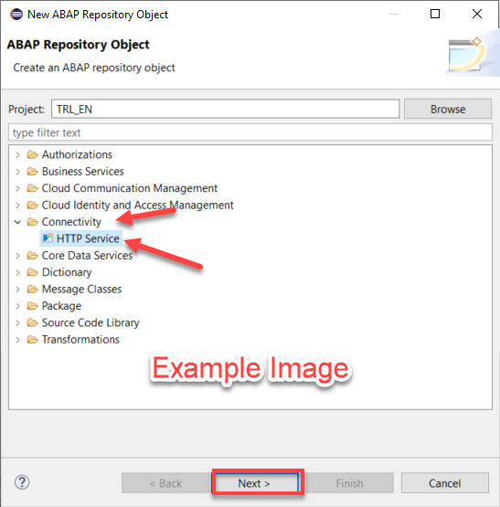

# Exercise 1 - Build the Golden Records in Dremio

Refine governed SAP data into trusted golden records using layered SQL views in Dremio, accelerated by reflections.

## Goal

**Resolve a non-SAP CRM to governed SAP customers and prove the churn ↔ delivery link** — the golden records Exercise 2 models into an ontology and Exercise 3's agent reasons over.

## Exercise 1 Data

For this exercise you work with two datasets, SAP and non-SAP:

- **SAP** data products under `"teched_labs_sandbox"."sap_dp"` — `customer`, `salesorderitem`, governed SAP S/4HANA data products from SAP Business Data Cloud (BDC): meaningful field names, business semantics, a defined contract.
- **Non-SAP** CRM export under `"teched_labs_sandbox"."non_sap"` — read-only.

> **Where your objects land:** every view you create lands in this exercise's folder, `"teched_labs_sandbox"."hands-on-test"."ex1"`. Source tables stay in `sap_dp` / `non_sap` — you only *read* those. The folder is pre-created; if missing, create it in the Dremio UI first (`CREATE VIEW` won't create parent folders).

> **Run each block on screen.** Every SQL block below is complete and runnable against `"teched_labs_sandbox"."hands-on-test"."ex1"` — execute it and the result matches the screenshot beneath it.

## Section 1.1 Resolve a non-SAP CRM to SAP customers

**Goal:** resolve non-SAP CRM accounts to SAP customers, then answer one cross-domain question:

> *"Are our at-risk renewals being driven by our own delivery performance?"*

CRM owns the relationship (accounts, cases, renewals); SAP owns the transaction (actual delivery). Joining CRM churn signals to SAP delivery (OTIF) surfaces the link between them.

Build two views, one per gap:

| View | What it is |
|---|---|
| `v_customer_otif` | Per-customer OTIF truth, rolled up from SAP sales-order lines (the SAP-side metric). |
| `v_crm_account_resolved` | The **Account → Customer crosswalk** — the resolution/MDM step, with `match_method` recording *how* each account resolved. |

### Step 1 — Preview what you're connecting

Preview the CRM accounts (messy names, a `churn_risk`, a `renewal_date`, no SAP key) and cases (dominated by delivery complaints):

```sql
SELECT crm_account_id, account_name, segment, churn_risk, nps, renewal_date
FROM "teched_labs_sandbox"."non_sap".crm_account
LIMIT 20;

SELECT category, status, COUNT(*) n
FROM "teched_labs_sandbox"."non_sap".crm_case
GROUP BY category, status ORDER BY n DESC;
```

> **You should see** names that are clean (`US Large Cycles 5`), suffixed (`USC1 Inc.`), or mistyped (`CA Specialty Cyales 5 Ltd.`), with no SAP customer number; cases dominated by Delivery Delay and Short Shipment. Every CRM value imports as text (`nps` comes back as `'-21'`), so a guarded cast applies later.


---

### Step 2 — Build `v_customer_otif`

Roll `salesorderitem` up per `SoldToParty` into the per-customer OTIF metric, windowed to where committed dates are populated.

```sql
CREATE OR REPLACE VIEW "teched_labs_sandbox"."hands-on-test"."ex1".v_customer_otif AS
SELECT
  SoldToParty AS "Customer",
  COUNT(*) AS lines,
  SUM(CASE WHEN CommittedDeliveryDate IS NOT NULL AND CommittedDeliveryDate<>'' THEN 1 ELSE 0 END) AS committed_lines,
  ROUND(100.0*AVG(CASE WHEN CommittedDeliveryDate IS NULL OR CommittedDeliveryDate='' THEN NULL
                       WHEN CommittedDeliveryDate <= RequestedDeliveryDate THEN 1.0 ELSE 0.0 END),1) AS pct_on_time,
  ROUND(100.0*AVG(CASE WHEN TotalDeliveryStatus='C' THEN 1.0 ELSE 0.0 END),1) AS pct_in_full,
  ROUND(100.0*AVG(CASE WHEN CommittedDeliveryDate IS NULL OR CommittedDeliveryDate='' THEN NULL
                       WHEN CommittedDeliveryDate <= RequestedDeliveryDate AND TotalDeliveryStatus='C' THEN 1.0 ELSE 0.0 END),1) AS otif_pct,
  SUM(CASE WHEN CommittedDeliveryDate IS NOT NULL AND CommittedDeliveryDate<>'' AND CommittedDeliveryDate > RequestedDeliveryDate THEN 1 ELSE 0 END) AS late,
  SUM(CASE WHEN TotalDeliveryStatus IN ('A','B') THEN 1 ELSE 0 END) AS short
FROM "teched_labs_sandbox"."sap_dp".salesorderitem
WHERE RequestedDeliveryDate >= '2023-01-01'
GROUP BY SoldToParty;
```

> **Quoted mixed-case aliases** (`"Customer"`) preserve the Databricks-style names; once quoted, later references are case-sensitive.

---

### Step 3 — Build `v_crm_account_resolved`

The Account → Customer crosswalk. A few regex rules (upper-case, punctuation → space, strip legal suffixes) auto-resolve the *easy* names; everything harder defers to the golden crosswalk `crm_account_resolution_xref`, with `match_method` recording the winning path.

```sql
CREATE OR REPLACE VIEW "teched_labs_sandbox"."hands-on-test"."ex1".v_crm_account_resolved AS
WITH cust_norm AS (
  SELECT
    REGEXP_REPLACE(REGEXP_REPLACE(TRIM(REGEXP_REPLACE(UPPER(CustomerName),'[^A-Z0-9]+',' ')),
      ' (INC|LLC|CO|CORP|GMBH|AG|KG|LTD|GROUP|SA DE CV|S DE RL)$',''),' ','') AS cn,
    MIN(Customer) AS one_customer,
    COUNT(DISTINCT Customer) AS ncust
  FROM "teched_labs_sandbox"."sap_dp".customer
  GROUP BY REGEXP_REPLACE(REGEXP_REPLACE(TRIM(REGEXP_REPLACE(UPPER(CustomerName),'[^A-Z0-9]+',' ')),
      ' (INC|LLC|CO|CORP|GMBH|AG|KG|LTD|GROUP|SA DE CV|S DE RL)$',''),' ','')
),
fuzzy AS (
  SELECT a.crm_account_id, cn2.one_customer AS fuzzy_sap_id, cn2.ncust
  FROM "teched_labs_sandbox"."non_sap".crm_account a
  LEFT JOIN cust_norm cn2
    ON REGEXP_REPLACE(REGEXP_REPLACE(TRIM(REGEXP_REPLACE(UPPER(a.account_name),'[^A-Z0-9]+',' ')),
         ' (INC|LLC|CO|CORP|GMBH|AG|KG|LTD|GROUP|SA DE CV|S DE RL)$',''),' ','') = cn2.cn
)
SELECT
  x.crm_account_id,
  x.sap_customer_id,                       -- authoritative golden crosswalk (MDM / xref)
  x.name_match_difficulty,
  f.fuzzy_sap_id,
  CASE
    WHEN f.fuzzy_sap_id IS NOT NULL AND f.ncust = 1 AND f.fuzzy_sap_id = x.sap_customer_id THEN 'fuzzy_auto'
    WHEN f.ncust > 1 THEN 'ambiguous_needs_mdm'
    ELSE 'mdm_resolved'
  END AS match_method
FROM "teched_labs_sandbox"."non_sap".crm_account_resolution_xref x
LEFT JOIN fuzzy f ON f.crm_account_id = x.crm_account_id;
```

> **`match_method` is the honest MDM boundary.** The regex is a proxy: it resolves clean names on its own (`fuzzy_auto`) and lets you *see* where fuzzy matching breaks down. Everything harder (`mdm_resolved`, `ambiguous_needs_mdm`) is what only a real master-data management (MDM) solution could settle — entity resolution, survivorship, stewardship, a maintained golden crosswalk. Here `crm_account_resolution_xref` stands in for that MDM output.


---

## Section 1.2 Build & materialize the CRM 360 golden record

Join CRM and SAP into one ontology-ready product, materialize it, and confirm the link.

| View | What it is |
|---|---|
| `v_crm_account_360` | The **ontology-ready golden account product**: CRM + resolved SAP customer + OTIF + case counts. The one you materialize. |

### Step 1 — Build `v_crm_account_360`

Join CRM account → resolved customer (`v_crm_account_resolved`) → `v_customer_otif` → case counts, with the guarded cast on text columns.

```sql
CREATE OR REPLACE VIEW "teched_labs_sandbox"."hands-on-test"."ex1".v_crm_account_360 AS
WITH cases AS (
  SELECT crm_account_id,
         SUM(CASE WHEN status='Open' THEN 1 ELSE 0 END) AS open_cases,
         SUM(CASE WHEN category='Delivery Delay' THEN 1 ELSE 0 END) AS delivery_delay_cases,
         SUM(CASE WHEN category='Short Shipment' THEN 1 ELSE 0 END) AS short_shipment_cases
  FROM "teched_labs_sandbox"."non_sap".crm_case GROUP BY crm_account_id
)
SELECT
  a.crm_account_id, a.account_name, a.segment, a.billing_country, a.billing_region,
  CASE WHEN REGEXP_LIKE(a.health_score, '^-?[0-9]+$')          THEN CAST(a.health_score AS INTEGER) END AS health_score,
  CASE WHEN REGEXP_LIKE(a.nps, '^-?[0-9]+$')                    THEN CAST(a.nps AS INTEGER) END          AS nps,
  a.churn_risk,
  CASE WHEN REGEXP_LIKE(a.annual_contract_value, '^-?[0-9]+$')  THEN CAST(a.annual_contract_value AS INTEGER) END AS annual_contract_value,
  a.renewal_date, a.csm_owner,
  r.sap_customer_id, r.match_method, r.name_match_difficulty,
  cu.CustomerName, cu.Country, cu.Industry,
  o.otif_pct, o.pct_on_time, o.pct_in_full, o.late AS late_lines, o.short AS short_lines, o.committed_lines,
  COALESCE(ca.open_cases,0) AS open_cases,
  COALESCE(ca.delivery_delay_cases,0) AS delivery_delay_cases,
  COALESCE(ca.short_shipment_cases,0) AS short_shipment_cases
FROM "teched_labs_sandbox"."non_sap".crm_account a
JOIN "teched_labs_sandbox"."hands-on-test"."ex1".v_crm_account_resolved r ON r.crm_account_id = a.crm_account_id
LEFT JOIN "teched_labs_sandbox"."sap_dp".customer cu ON cu.Customer = r.sap_customer_id
LEFT JOIN "teched_labs_sandbox"."hands-on-test"."ex1".v_customer_otif o ON o."Customer" = r.sap_customer_id
LEFT JOIN cases ca ON ca.crm_account_id = a.crm_account_id
WHERE a.churn_risk <> 'Unmanaged';
```

> **Why the guarded cast?** Metric columns import as strings, and some rows carry a unit token (e.g. `EA`) instead of a number — a plain `CAST` errors. The `REGEXP_LIKE(..., '^-?[0-9]+$')` guard casts only numeric-looking values — the same behavior as Databricks `try_cast`.

---

### Step 2 — Materialize the hand-off views

Dremio has no `CREATE MATERIALIZED VIEW` — you keep the view and enable a **Raw Reflection**, the physically stored, auto-maintained copy Dremio transparently substitutes to accelerate queries. Enable one on **`v_customer_otif`** (Exercise 2's required input) and on **`v_crm_account_360`**:

```sql
ALTER DATASET "teched_labs_sandbox"."hands-on-test"."ex1".v_customer_otif
CREATE RAW REFLECTION otif_raw USING DISPLAY (
  "Customer", lines, committed_lines, pct_on_time, pct_in_full, otif_pct, late, short
);

ALTER DATASET "teched_labs_sandbox"."hands-on-test"."ex1".v_crm_account_360
CREATE RAW REFLECTION crm360_raw USING DISPLAY (
  crm_account_id, account_name, segment, churn_risk, annual_contract_value, renewal_date,
  sap_customer_id, match_method, CustomerName, Country, Industry,
  otif_pct, pct_on_time, pct_in_full, late_lines, open_cases, delivery_delay_cases
);
```

> **The golden record is a view, not a copy.** Change a threshold and every downstream consumer — the ontology in Exercise 2, the agent in Exercise 3 — reflects it immediately, no pipeline re-run. The reflection gives physical speed without giving up the single logical source of truth.



---

### Step 3 — Confirm the link

Delivery performance by churn tier.

```sql
SELECT churn_risk, COUNT(*) accounts, ROUND(AVG(otif_pct),1) avg_otif,
       ROUND(AVG(nps),1) avg_nps, ROUND(AVG(open_cases),1) avg_open_cases
FROM "teched_labs_sandbox"."hands-on-test"."ex1".v_crm_account_360
GROUP BY churn_risk ORDER BY avg_otif;
```

> **You should see** a clean gradient — At Risk ≈ 79% OTIF / NPS −21 / ~13 open cases; Watch ≈ 82% / +11 / ~6; Healthy ≈ 93% / +25 / ~2. The churn signal tracks SAP delivery — discovered by the join, not assumed.


---

### Step 4 — The money query

At-risk, high-value renewals, each with how it was resolved.

```sql
SELECT account_name, sap_customer_id, otif_pct, late_lines, open_cases,
       annual_contract_value, renewal_date, match_method
FROM "teched_labs_sandbox"."hands-on-test"."ex1".v_crm_account_360
WHERE churn_risk='At Risk' ORDER BY otif_pct ASC LIMIT 10;
```

> **You should see** high-value at-risk renewals, each with low OTIF, many late lines and open delivery cases — some resolved by `fuzzy_auto`, others only by `mdm_resolved`. This materialized `v_crm_account_360`, with `v_customer_otif` and `v_crm_account_resolved`, is the hand-off to Exercises 2 and 3.


## Summary

You resolved a non-SAP CRM to governed SAP customers and built a CRM 360 golden record that confirms the churn ↔ delivery link: `v_customer_otif`, `v_crm_account_resolved`, and the materialized `v_crm_account_360` — Dremio views accelerated by reflections, sourced from SAP BDC data products. Exercise 2 builds its ontology on `v_customer_otif` and `v_crm_account_resolved`; Exercise 3's agent reasons over that ontology, with `v_crm_account_360` behind it. An optional [OTIF manufacturing medallion](optional/README.md) adds a deterministic shopfloor track for Exercise 3's secondary agent context.

Continue to - [Exercise 2 - Ontologies on the Golden Record](../ex2/README.md)