# Exercise 2 - Creating Ontology to define business concepts and relations

In this exercise, you will build a semantic ontology on top of the materialized views produced in Exercise 1, bringing together non-SAP CRM data and SAP data, adding relationships and semantics that the Joule agent in Exercise 3 can reason over.

This connects the two halves of the session: Exercise 1 produces the trusted, materialized golden record; Exercise 3 grounds an agent on it. The ontology built here is the bridge between them — the shared vocabulary (customers, orders, CRM accounts, fulfillment status) that makes the agent's answers precise and explainable.

## What this exercise covers

- Connecting SAP BDC Ontology Manager to the Dremio instance from Exercise 1
- Modeling SAP (`customer`, `salesorderitem`) and non-SAP CRM tables alongside the materialized `v_customer_otif` golden view into a unified ontology
- Assigning semantic concept names and attributes to each source table
- Defining named relationships that bridge CRM accounts to SAP customers and orders
- Previewing the resulting knowledge graph

## Prerequisites

- Exercise 1 completed: `v_customer_otif` exists in Dremio and its Raw Reflection is enabled.

## Steps

### Step 1 — Get your Dremio Personal Access Token (PAT)

You need a PAT from Dremio to authenticate the connection in the next step. Do this in the [Dremio UI](https://app.qaemea1.dremio.site/project/7448000a-bf81-48b0-a68b-df7dd74fbba2/) before switching to Ontology Manager.

**1a.** In Dremio, click your **avatar / initials** at the bottom-left of the navigation bar. Select **Account settings** from the popup menu.

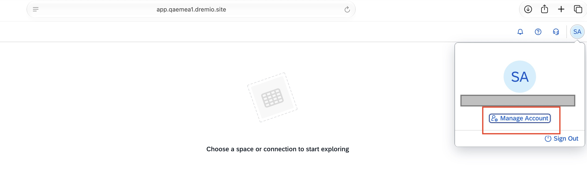

---

**1b.** In Account settings, click **Personal access tokens** in the left panel, then click **Generate token** (top right).

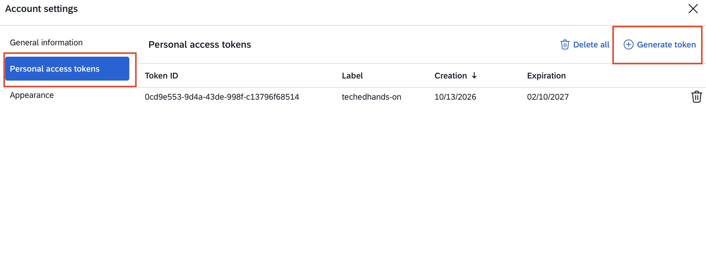

---

**1c.** In the Generate token dialog, enter a **Label** (e.g. `techedhands-on`) and leave the **Lifetime** at `30` days. Click **Generate**.

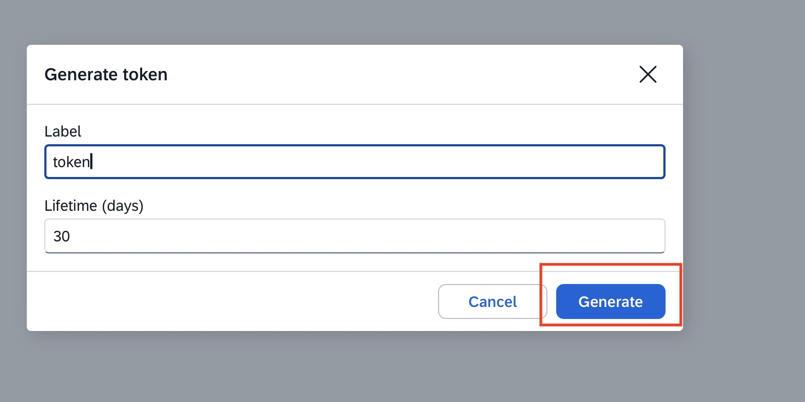

---

**1d.** The token is shown **once only** — copy it now using the copy icon, then click **OK**. Paste it somewhere safe (e.g. a text editor); you will need it in Step 4.

> **Important:** after you close this dialog the token value is no longer accessible in Dremio. If you lose it you will need to delete it and generate a new one.

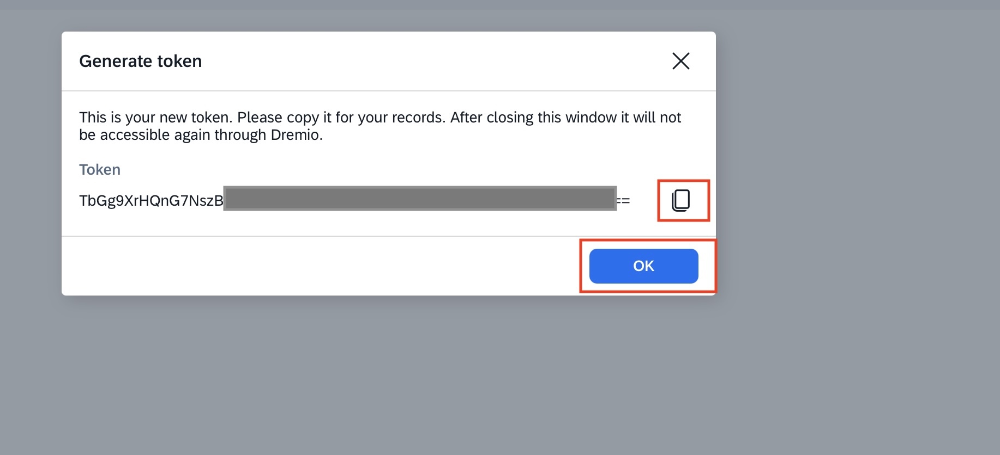

---

### Step 2 — Open Connection Management

In [SAP BDC Ontology Manager](https://nar-eu10-i05-sub-j4a26ouu-nar-eu10-i05-approuter.cfapps.eu10-005.hana.ondemand.com/dashboard), click **Connections** in the left-hand navigation.

You will see the Connection Management screen, which lists all existing data source connections.

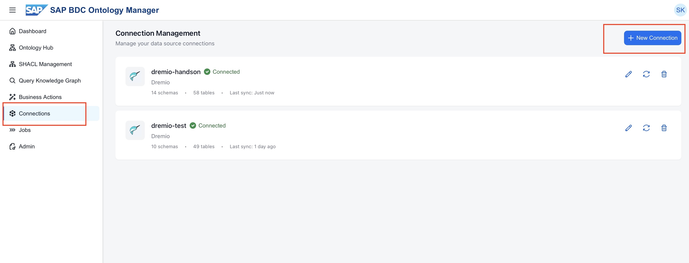

---

### Step 3 — Create a new Dremio connection

Click **+ New Connection** (top right). In the dialog that appears, select **Dremio**.

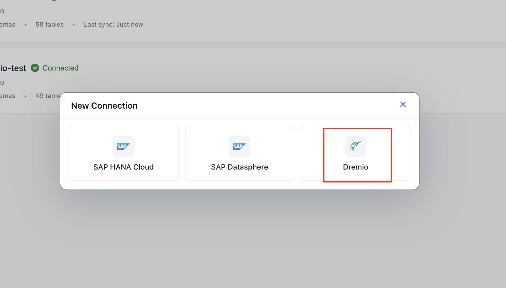

---

### Step 4 — Fill in the connection details

Complete the three required fields:

| Field | Value |
|---|---|
| **Connection Name** | `<your user number>-Dremio` (use your assigned station number, e.g. `xp267-001-Dremio`) |
| **JDBC URL** |  `jdbc:arrow-flight-sql://data.qaemea1.dremio.site:443?useEncryption=true&CATALOG=7448000a-bf81-48b0-a68b-df7dd74fbba2` |
| **Personal Access Token (PAT)** | retrieved in Step 1d above |

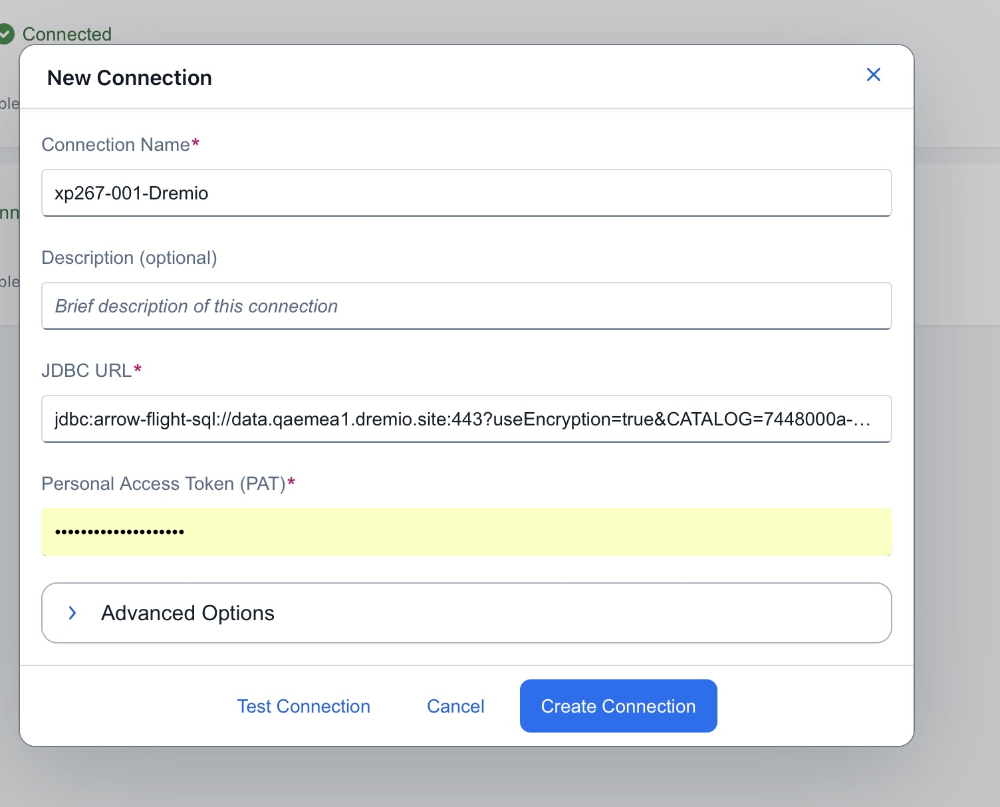

---

### Step 5 — Test the connection

Click **Test Connection**. Wait a moment for the validation to complete.

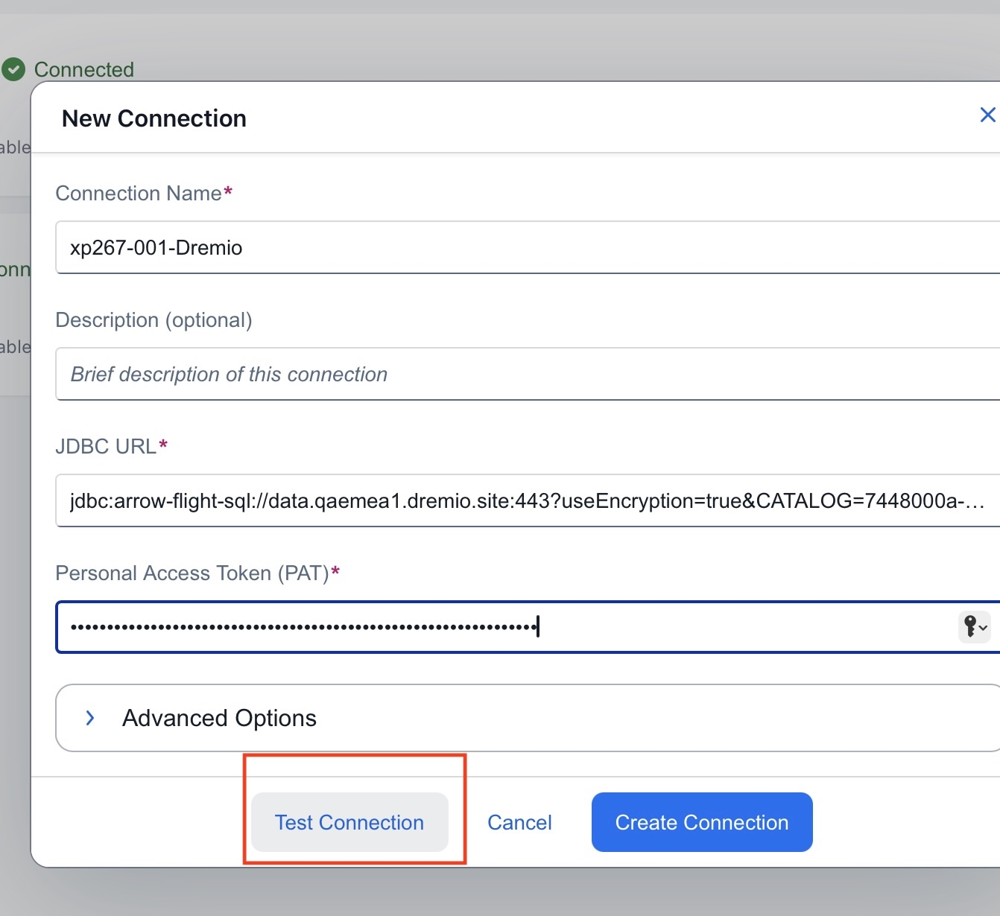

---

### Step 6 — Confirm a successful test, then create

A green **Connection successful** banner appears below the PAT field. Click **Create Connection**.

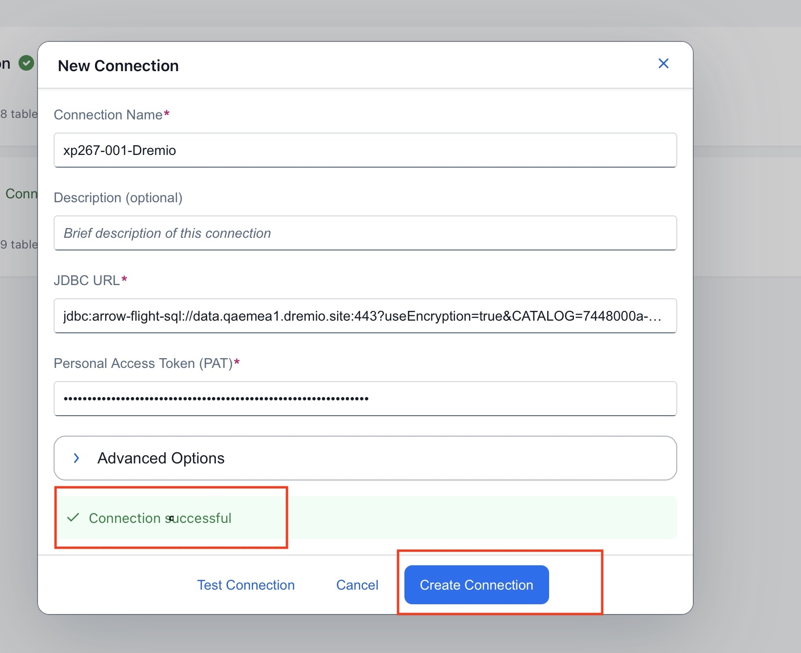

---

### Step 7 — Confirm the connection is listed as Connected

Back on the Connection Management screen, your new connection (`xp267-001-Dremio`) appears at the top with a green **Connected** badge and shows 14 schemas / 58 tables after its initial sync.

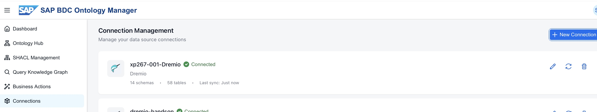

---

### Step 8 — Navigate to Ontology Hub

Click **Ontology Hub** in the left-hand navigation.

The Ontology Hub is where you create and manage all ontologies. Any previously created ontologies appear here as cards.

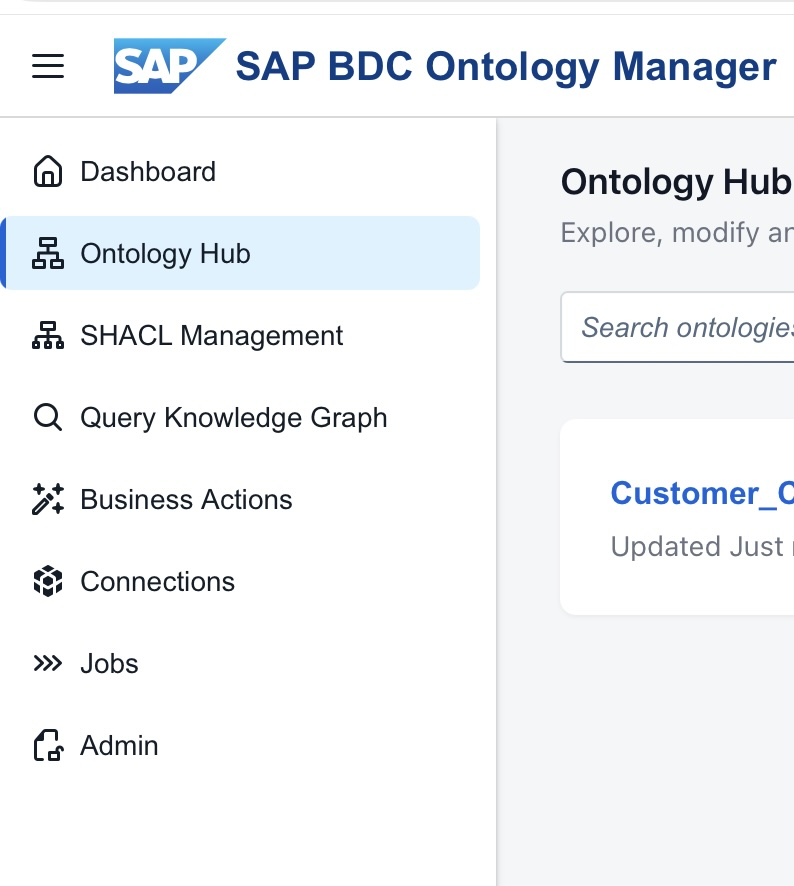

---

### Step 9 — Start creating a new ontology

Click **+ Create Ontology** (top right).

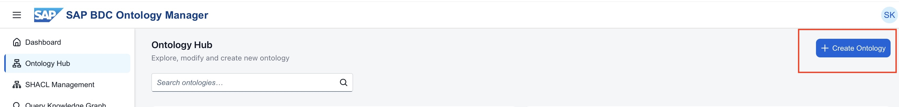

---

### Step 10 — Name & Description 

Fill in the ontology name and choose the data source type:

| Field | Value |
|---|---|
| **Ontology Name** | `Customer_Churn_Ontology_XP001` (replace `001` with your station number) |
| **Description** | *(optional)* |
| **Data Source** | `Database` |

Click **Next**.

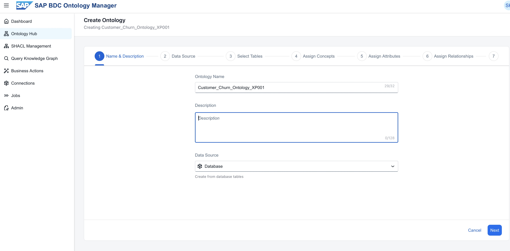

---

### Step 11 — Data Source 

Select the Dremio connection you just created (`xp267-001-Dremio`). It will be marked **connected** and shows 58 tables available. The connection syncs automatically when selected.

Click **Next**.

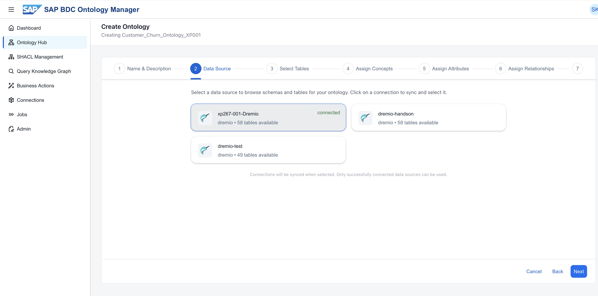

---

### Step 12 — Select Tables : SAP data-product tables

In the **Schema Source** panel, type `teched` to filter the schemas. Select **`teched_labs_sandbox.sap_dp`** — the schema containing the governed SAP data products.

In the **Select table** panel, check:
- `customer`
- `salesorderitem`

Both appear in the **Selected tables** panel on the right (count shows 2).

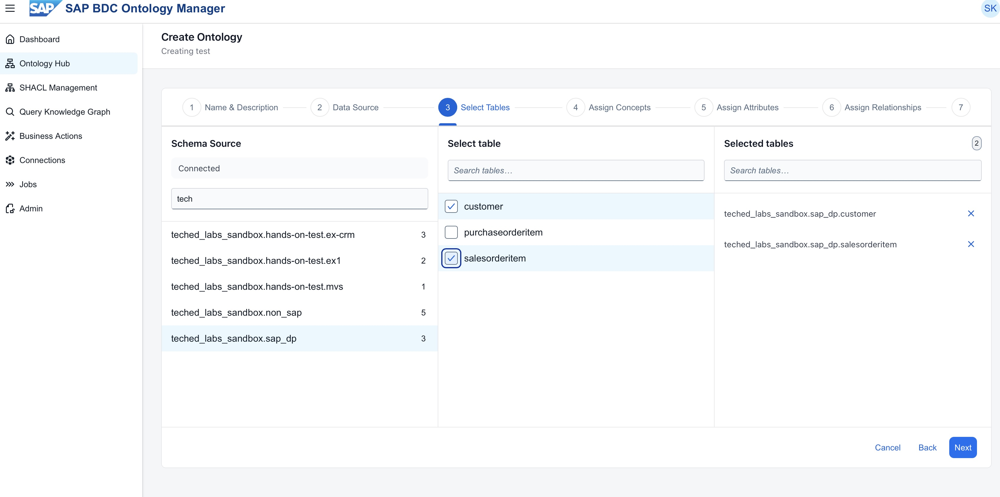

---

### Step 13 — Select Tables : non-SAP CRM tables

Now select **`teched_labs_sandbox.non_sap`** in the Schema Source panel.

Check all five CRM tables:
- `crm_account`
- `crm_account_resolution_xref`
- `crm_case`
- `crm_contact`
- `crm_opportunity`

The Selected tables count rises to 7.

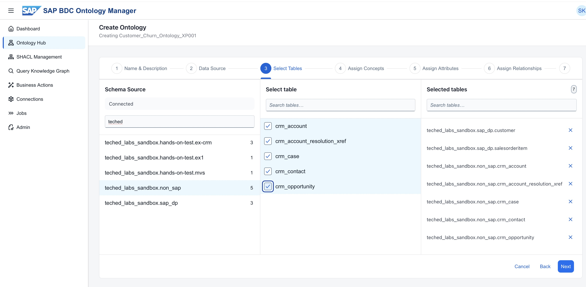

---

### Step 14 — Select Tables : add the golden view

Select **`<your space>`** (eg `xp267-001` depending on your setup) in the Schema Source panel, then check:
- `v_crm_account_resolved`
- `v_customer_otif`

The Selected tables count rises to 9.

> `v_customer_otif` is the materialized golden record from Exercise 1 — this is the key hand-off between exercises.

Click **Next**.
 ( Image to be updated once we have individual spaces created ) 

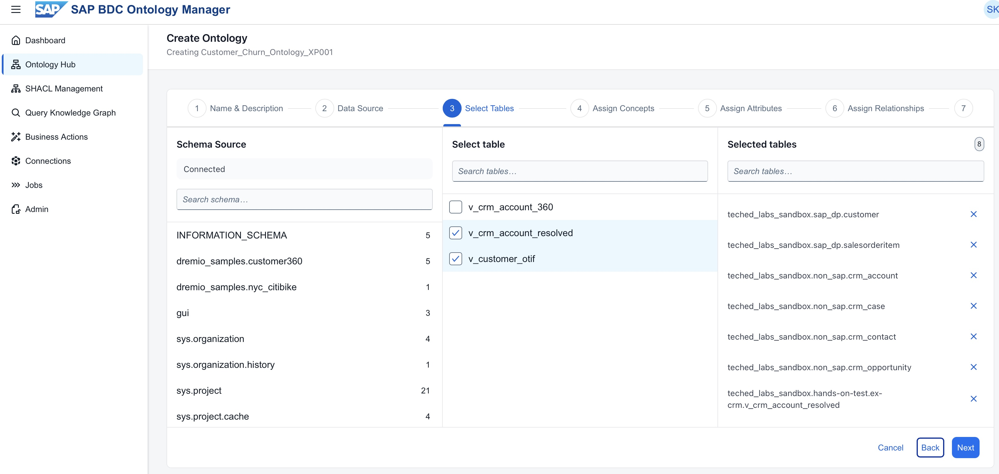

---

### Step 15 — Assign Concepts : auto-generate

In the Assign Concepts step, each selected table needs a semantic concept name. Click **Auto Generate Concepts** to let the system propose names based on the table names.

> The banner notes "LLMs can make mistakes; please double-check the auto-generated content."

Review the generated names. The mapping should look like this:

| Table | Concept name |
|---|---|
| `teched_labs_sandbox.sap_dp.customer` | `Customers` |
| `teched_labs_sandbox.sap_dp.salesorderitem` | `Salesorderitems` |
| `teched_labs_sandbox.non_sap.crm_account` | `CrmAccount` |
| `teched_labs_sandbox.non_sap.crm_account_resolution_xref` | `CrmAccountResolutionXref` |
| `teched_labs_sandbox.non_sap.crm_case` | `CrmCase` |
| `teched_labs_sandbox.non_sap.crm_contact` | `CrmContact` |
| `teched_labs_sandbox.non_sap.crm_opportunity` | `CrmOpportunity` |
| `...v_crm_account_resolved` | `VCrmAccountResolved` |
| `...v_customer_otif` | `VCustomerOrderFulfillment` |

> NOTE: Rename 'Customer' to 'Customers' and 'SalesOrderItem' to 'SalesOrderItems', this is required as there are attributes with same name as table names in these two tables and continuing without renaming will show errors later. Now click **Next**.

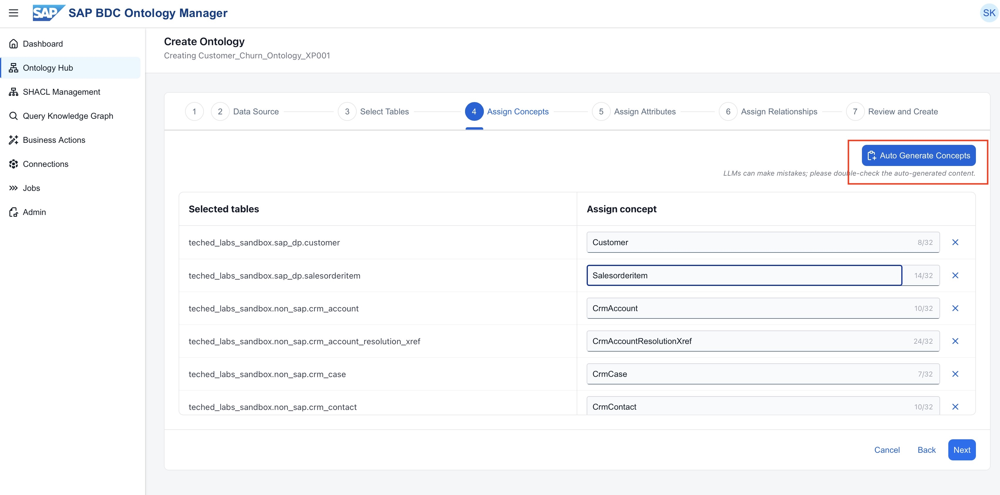

---

### Step 16 — Assign Attributes  

For each concept, select its **Primary Attribute** (the unique identifier column) and optionally add attributes to expose.

Click each concept in the left panel to configure it:

1. Select **Customers** — set Primary Attribute to `Customer`. Click **+ Add All** to include all columns as attributes.
2. Repeat for each remaining concept, setting the primary key column as the Primary Attribute.

The attributes panel shows the column name on the left and the semantic property name (editable) on the right, with its data type badge.

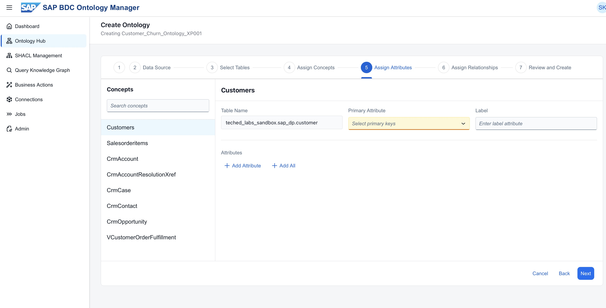

Use the table below as a reference when setting each concept's Primary Attribute:

| Concept | Source table | Primary Attribute (IRI key) |
|---|---|---|
| `Customers` | `sap_dp.customer` | `Customer` |
| `Salesorderitems` | `sap_dp.salesorderitem` | `SalesOrder` |
| `CrmAccount` | `non_sap.crm_account` | `crm_account_id` |
| `CrmAccountResolutionXref` | `non_sap.crm_account_resolution_xref` | `crm_account_id` |
| `CrmCase` | `non_sap.crm_case` | `case_id` |
| `CrmContact` | `non_sap.crm_contact` | `contact_id` |
| `CrmOpportunity` | `non_sap.crm_opportunity` | `opportunity_id` |
| `VCrmAccountResolved` | `v_crm_account_resolved` | `crm_account_id` |
| `VCustomerOrderFulfillment` | `v_customer_otif` | `Customer` |

> **Note on `Salesorderitems`:** the source table has a composite key (`SalesOrder` + `SalesOrderItem`). Select `SalesOrder` as the Primary Attribute here.

Click **Next** once all concepts have a Primary Attribute set.

---

### Step 17 — Assign Relationships  

Define the named relationships that link concepts across the two data domains. Click **+ Add Relationship** for each concept that has connections to other concepts.

Add the following relationships (visible in the summary screenshot):

| Source Concept | Relationship Name | Target Concept | Source Attribute | Target Attribute |
|---|---|---|---|---|
| `Customers` | `hasOTIF` | `VCustomerOrderFulfillment` | `Customer` | `Customer` |
| `Customers` | `placesOrder` | `Salesorderitems` | `Customer` | `SoldToParty` |
| `CrmAccount` | `hasCase` | `CrmCase` | `crm_account_id` | `crm_account_id` |
| `CrmAccount` | `hasContact` | `CrmContact` | `crm_account_id` | `crm_account_id` |
| `CrmAccount` | `hasOpportunity` | `CrmOpportunity` | `crm_account_id` | `crm_account_id` |
| `CrmCase` | `referencesOrder` | `Salesorderitems` | `related_sales_order` | `SalesOrder` |
| `VCrmAccountResolved` | `resolvesTo` | `Customers` | `sap_customer_id` | `Customer` |
| `CrmAccount` | `resolvedBy` | `VCrmAccountResolved` | `crm_account_id` | `crm_account_id` |

For each relationship, set the **Source Concept**, type the **Relationship Name**, pick the **Target Concept**, then map the **Source Attribute** and **Target Attribute** join columns.

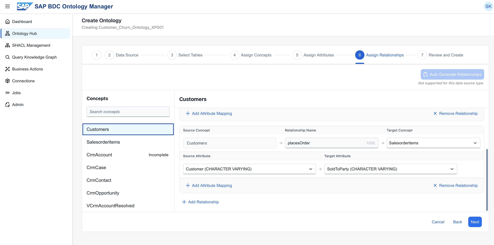

> Note: **Auto Generate Relationships** is greyed out for Dremio sources ("Not supported for this data source type") — you must define them manually.

Click **Next**.

---

### Step 18 — Review and Create 

The final step shows a summary of the ontology: its name, all concepts as coloured dots, and every relationship as a row showing Source → Relationship → Target.

Verify the summary shows **8 concepts** and **8 relationships**, then click **Create**.

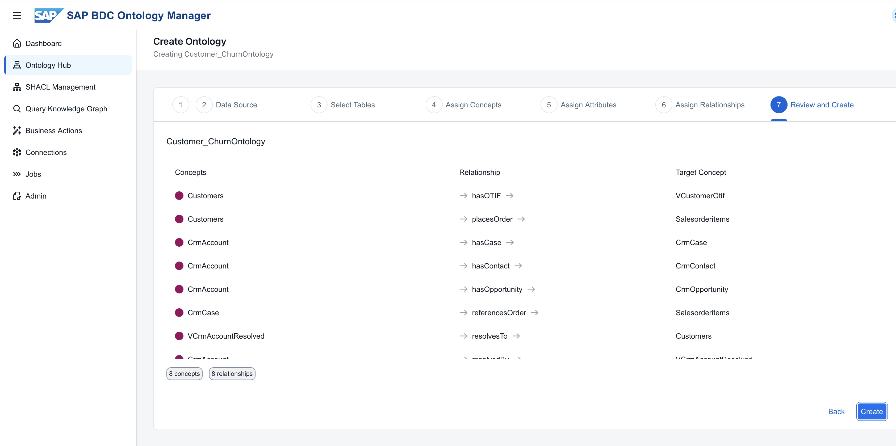

---

### Step 19 — Ontology created: explore the virtual graph

After creation, Ontology Manager opens the ontology's detail page. The centre panel renders the **Virtual Ontology** — an interactive graph showing all concepts as coloured nodes connected by labelled edges.

- Click any node to see its properties, source table, and attributes in the **Properties** panel on the right.
- The left panel lists all concepts with their attribute and relationship counts.
- Use the **Generate KG** button to materialize the knowledge graph, or **Preview KG** to query it first.

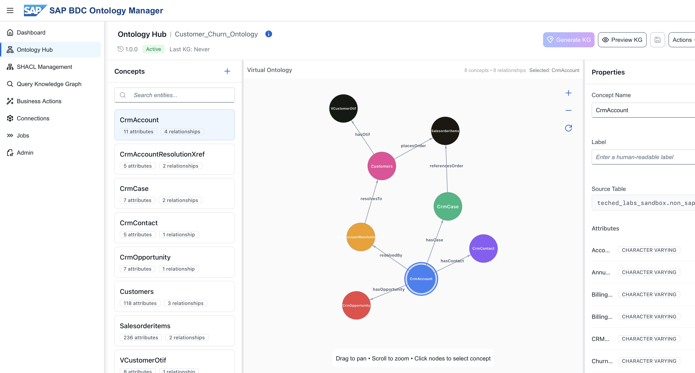

---

### Step 20 — Preview the Knowledge Graph

Click **Preview KG** (top right of the ontology detail page). The **Preview Knowledge Graph** dialog opens.

Switch between **SPARQL** and **Visual Query** modes. In Visual Query mode:

1. Add filters using concept + attribute + value rows.
2. Click **Run Visual Query**.

The results table at the bottom shows live data resolved from Dremio through the ontology — for example, querying `CrmAccount.AccountName` and `Customers.Customer` returns matched account–customer pairs.

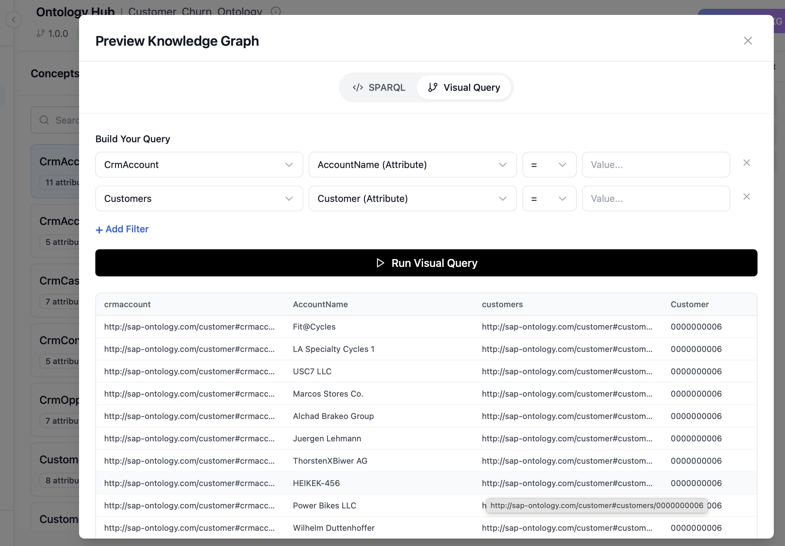

---

### Step 21 — Ontology Hub: confirm the ontology is active

Return to **Ontology Hub** (left navigation). Your new ontology appears as a card marked as shown and **Active**.

This ontology is now ready for Exercise 3 — the Joule agent will ground on it to answer natural-language questions across the CRM and SAP domains.

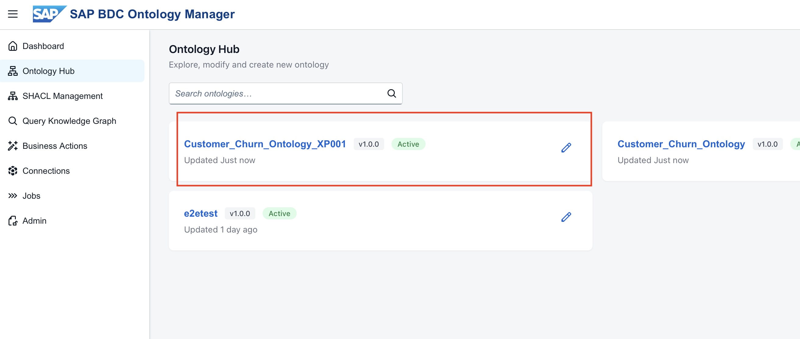

---

## Summary

You connected SAP BDC Ontology Manager to Dremio, then built a 9-table, 8-concept, 8-relationship ontology that bridges SAP customer/order data with non-SAP CRM data via the `v_customer_otif` golden record from Exercise 1. The knowledge graph is now active and queryable — the semantic foundation Exercise 3's Joule agent will reason over.

Continue to - [Exercise 3 - Build a Joule Agent on the Golden Record](../ex3/README.md)
