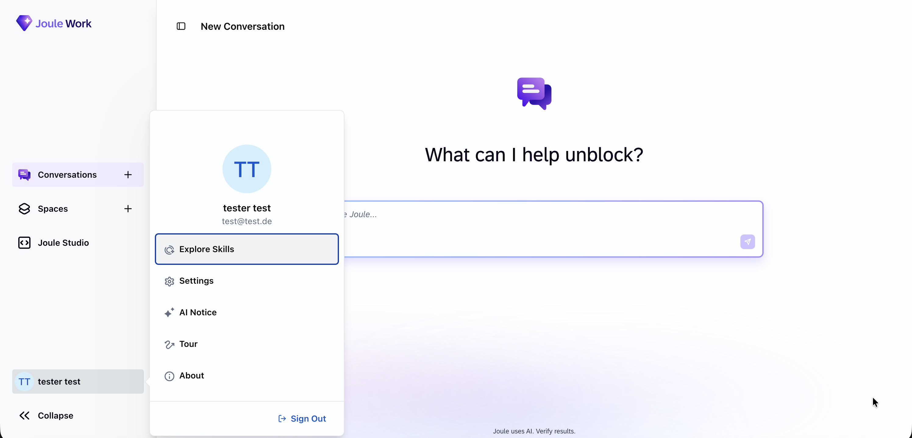
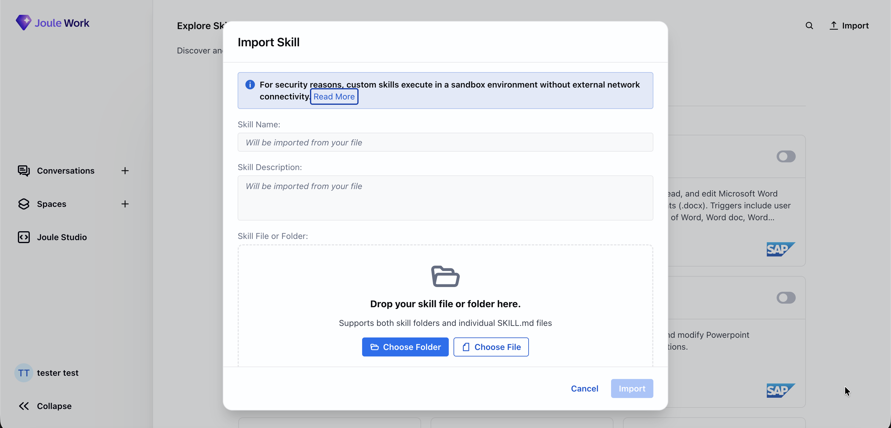
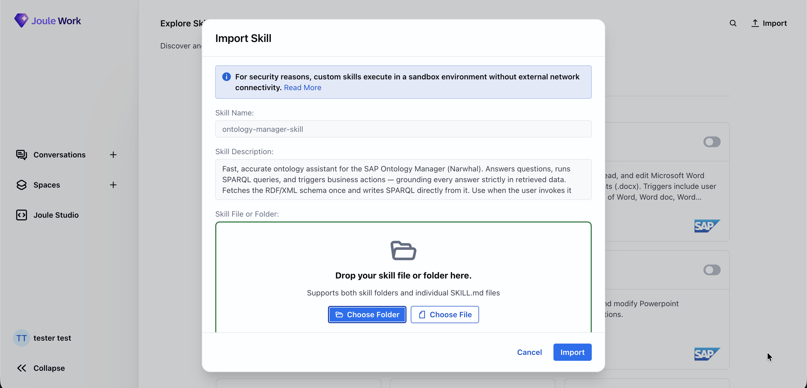
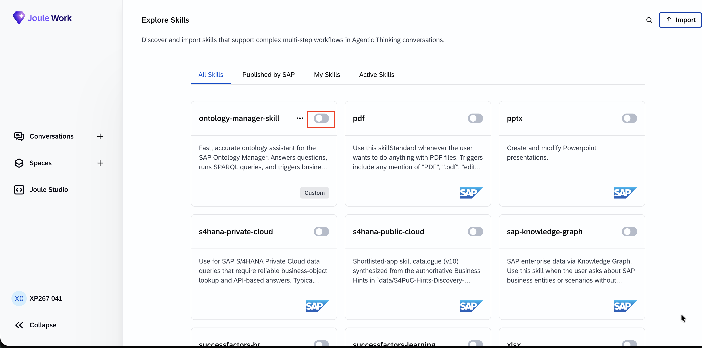

# Exercise 3 - Build a Joule Skill on the Golden Record

In this exercise you ground **Joule** on the knowledge graph you built in the SAP BDC
Ontology Manager, which sits on top of the golden records from the earlier exercises. You import a
prepared **Joule skill** into Joule Work, turn it on, and ask customer-churn and delivery-performance
questions in a normal conversation.

> The skill (`ontology-manager-skill/`) is ready to use. Its connection to the Ontology Manager
> is wired through a **BTP destination** that the Joule runtime resolves for you — there are no
> credentials to paste and no code to edit. You import the folder, enable it, and start asking
> questions.

## Prerequisites

- The SAP BDC Ontology Manager golden-record ontology published for your lab tenant.
- Access to **Joule Work** for your lab tenant (browser only — nothing is installed on your
  laptop).
- The `ontology-manager-skill/` folder from this directory, available on the machine you are
  browsing from (clone the repo or download the folder).

## Exercise 3.1 Import and enable the skill

When you finish these steps, the `ontology-manager-skill` is active in your Joule Work account
and grounded on your tenant's Ontology Manager.

### Step 1 — Look at the skill before you import it

Before importing, open the `ontology-manager-skill/` folder in this exercise and skim its three
files — the whole skill is small enough to read in a couple of minutes, and knowing what's inside
makes the later steps make sense.

```
ontology-manager-skill/
  SKILL.md                   # the instructions Joule follows (grounding rules + tool reference)
  .sap-connectivity.json     # declares the BTP destination the skill reaches through
  scripts/
    ask_ontology_manager.py           # thin client that calls the Ontology Manager MCP tools
```

- **`SKILL.md`** is the heart of the skill — plain-English instructions that tell Joule to pin
  the ontology, cache its schema, write SPARQL from that schema, and never answer from memory. It
  also lists the MCP tools the skill can call. Read the top of it to see the grounding contract.
- **`.sap-connectivity.json`** declares a single connector pointing at a BTP **destination**
  (`ONTOLOGY_MANAGER_TECHED_HANDSON_1`). This is the one line that wires the skill to your tenant's
  Ontology Manager — and the reason you never paste a credential.
- **`scripts/ask_ontology_manager.py`** is a small helper that posts a request to the Ontology Manager and
  returns the result. You don't edit it; `SKILL.md` tells Joule when to run it.

> You don't change anything in these files. This step is just so the skill isn't a black box
> before you turn it on. [What the skill does](#what-the-skill-does-for-the-curious) at the end
> unpacks the grounding rules in more detail.

---

### Step 2 — Open Explore Skills

Open **Joule** in your browser and sign in: [https://747391938.eu10.sapdas.cloud.sap/](https://747391938.eu10.sapdas.cloud.sap/)

> On a brand-new account, Joule Work opens a short onboarding wizard (a welcome splash, then a
> few feature-tour cards). It's not part of this exercise — click **Skip** (or step through it
> with **Next**) to reach the main Joule Work screen.

In the bottom-left of the navigation bar, click your **user ID** (your name / initials). In the
popup menu, click **Explore Skills**.



---

### Step 3 — Open the Import dialog

The **Explore Skills** gallery lists every skill available to you — the ones **Published by SAP**
(Ariba, Word, PDF, PowerPoint, …) and any **Custom** skills your account has imported.

In the top-right, click **Import**.



---

### Step 4 — Choose the skill folder

In the **Import Skill** dialog, click **Choose Folder** and select the
`ontology-manager-skill/` folder from this exercise (it contains `SKILL.md`,
`.sap-connectivity.json`, and a `scripts/` folder). The **Skill Name** and **Skill Description**
fill in automatically from the folder's `SKILL.md`. Then click **Import**.

> The notice in the dialog — *"custom skills execute in a sandbox environment without external
> network connectivity"* — is expected. This skill does **not** make its own outbound call: it
> reaches the Ontology Manager through a **BTP destination** that the Joule runtime resolves and
> proxies for it, so it works inside the sandbox without any network egress of its own. That is
> exactly why there are no credentials to configure.



---

### Step 5 — Enable the skill

Back in the gallery (the **All Skills** tab), find the imported **ontology-manager-skill** card
(marked **Custom**). Click the **toggle** at the top-right of that card to switch it **on** — it's
the small switch next to the card's `•••` menu, and it starts greyed out / off. Once it shows as
active, Joule will reach for it whenever you ask about ontologies, the knowledge graph, or
customer-churn and delivery data.



> No connection details to fill in. The skill carries its own `.sap-connectivity.json`, and the
> Joule runtime binds it to your tenant's Ontology Manager destination for you. If the skill is
> enabled but answers fail, it is almost always because the destination isn't provisioned for your
> tenant — ask the lab host.

---

## Exercise 3.2 Ask the skill churn & delivery questions

Now test the skill in a conversation. These questions use the **`Customer_Churn_Ontology`** —
the governed knowledge graph that links your CRM accounts (churn risk, renewals, NPS) to your
real SAP delivery performance (OTIF), the churn ↔ delivery link you proved in Exercise 1.3.

Open a **New Conversation** in Joule Work and type the questions below into the chat box.

### Step 6 — Check that it reads from the governed data

First confirm Joule looks up the ontology before it answers. Paste this question:

```text
What data can you help me with? Use the Customer_Churn_Ontology — list it, then
describe what entities and attributes are available.
```

Joule should load the skill, list the ontology, and describe its entities — rather than answer
from general knowledge. On its first turn the skill pins the ontology and caches its schema, so
you may see it confirm the ontology name and class count before you ask anything else.

---

### Step 7 — Ask it to query the knowledge graph for real rows

Ask a question that forces the skill to run a SPARQL query against the knowledge graph:

```text
Which accounts are rated "At Risk" for churn? For each, show its OTIF delivery
performance, renewal date, and NPS. Cite the account.
```

The answer should cite specific accounts with their OTIF, renewal date, and NPS pulled from the
graph.

---

### Step 8 — Ask the churn-risk question

Finally, ask Joule to connect delivery performance to the money at stake:

```text
Rank the "At Risk" renewals by worst delivery performance, and tell me what each
one is costing — ACV at stake, days to renewal, and the delivery failures driving
the risk.
```

> The skill answers only from the knowledge graph: it looks up the ontology, reads its schema,
> and runs SPARQL, so every answer traces back to the governed data. The payoff is the churn ↔
> delivery link made actionable — at-risk renewals ranked by the OTIF failures threatening them,
> with the ACV on the line. When the data doesn't support an answer, the skill says so instead
> of guessing.

---

## What the skill does (for the curious)

The skill's behavior is defined entirely in `ontology-manager-skill/SKILL.md` — the instructions
Joule follows. Three rules in there are what make the answers trustworthy, and you can watch them
happen in the conversation:

1. **It grounds itself once, up front.** On the first turn it looks up the ontology, pins its
   UUID, and caches the schema — then stops and waits for your question. (This is the "ontology
   name and class count" confirmation you saw in Step 6.)
2. **It writes SPARQL from the real schema.** It reads the cached RDF/XML schema and builds each
   query from the actual class and property names in your ontology — it never invents field
   names.
3. **It never answers from memory.** Every value in an answer must come back from a live
   `execute_sparql` result. If the data doesn't support an answer, the skill says so instead of
   guessing — which is why the churn-risk answer in Step 8 traces back to real rows.

## How it connects (for the curious)

The skill is three files: `SKILL.md` (the instructions Joule follows — pin the ontology, cache
the schema, write SPARQL, never answer from memory), `scripts/ask_ontology_manager.py` (a thin client that
POSTs JSON-RPC to the Ontology Manager MCP server), and `.sap-connectivity.json` (which declares
a `destination` connector, `ONTOLOGY_MANAGER_TECHED_HANDSON_1`).

```
Joule Work conversation ──▶ ontology-manager-skill
                              │  scripts/ask_ontology_manager.py
                              │   • reads the proxy URL the runtime injects
                              ▼
         POST <proxy>/mcp-json/   (JSON-RPC: tools/call)
                              ▼
         BTP destination proxy (handles auth) ──▶ Ontology Manager MCP
                              ▼
                   SPARQL over the governed knowledge graph
```

At runtime the Joule platform reads `.sap-connectivity.json`, resolves the named destination, and
injects a proxy URL into the skill's environment (`API_ONTOLOGY_MANAGER_SKILL_AGENT`). The script
POSTs to that proxy and the **destination proxy attaches the credentials** — so no token ever
lives in the skill. The Ontology Manager turns the SPARQL into live queries over the
golden-record views. The MCP tools the skill uses are `list_ontologies`, `get_ontology_schema`,
and `execute_sparql` (plus `list_business_actions` / `execute_business_action` for triggering
actions).

## Screenshots to capture (for authors)

- [x] `03_01_0000.png` — Joule Work user menu with Explore Skills
- [x] `03_01_0005.png` — Explore Skills gallery (ontology-manager-skill shown as Custom / active)
- [x] `03_01_0010.png` — Import Skill dialog with name/description pre-filled from SKILL.md
- [x] `03_01_0015.png` — ontology-manager-skill card with the enable toggle highlighted
- [ ] `03_02_0000.png` — New Conversation with the skill listing the Customer_Churn_Ontology / entities
- [ ] `03_02_0010.png` — Joule ranking at-risk renewals by delivery performance with citations

## Summary

You grounded Joule on the governed knowledge graph built on your golden records — without
deploying anything or handling a single credential. Joule turns the churn ↔ delivery link into
an answer a renewals team can act on: at-risk accounts ranked by the OTIF failures driving their
risk, with the ACV at stake. Every answer is grounded in retrieved data and traces back through
the Ontology Manager to the underlying SAP data.

Return to - [Overview](../../../README.md)
