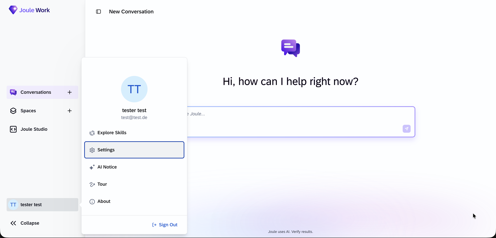
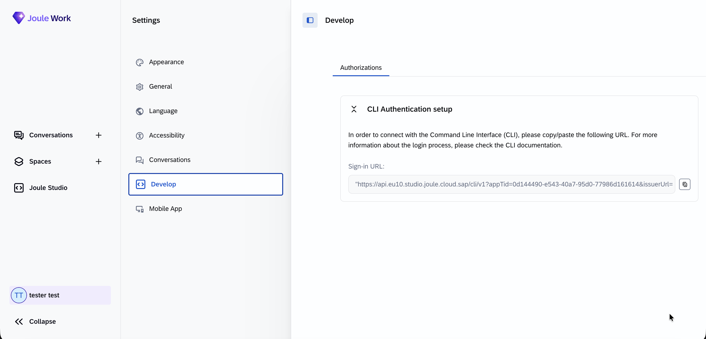
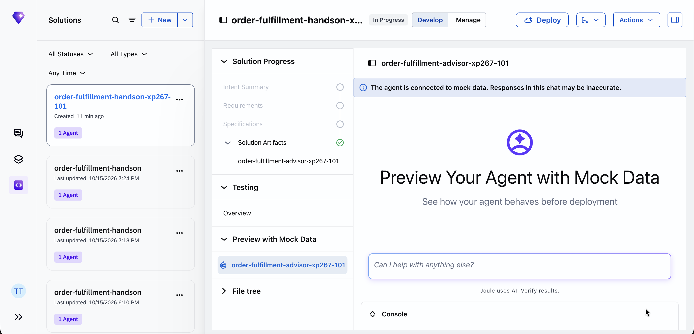

# Exercise 3 - Build a Joule Agent on the Golden Record

In this exercise you deploy a Joule Studio agent that answers order-fulfillment questions
in plain language. The agent is grounded on the knowledge graph you built in the SAP BDC
Ontology Manager, which sits on top of the golden records from the earlier exercises.

You deploy it the pro-code way: use the `jl` CLI to push a prepared agent solution, then
test it in a conversation.

> The agent's code (`exercises/ex3/js-agent/solution/`) is ready to deploy. The MCP tool
> wiring to the Ontology Manager is already in place — you just add your tenant's SAP BDC
> Ontology Manager connection details (Step 4) so it can authenticate, then deploy and ask
> questions. See [`solution/README.md`](solution/README.md) for the details.

## Prerequisites

- The SAP BDC Ontology Manager golden-record ontology published for your lab tenant. You
  install Node.js and the `jl` CLI in Step 1 below.

## Exercise 3.1 Deploy the agent

When you finish these steps, the `Order Fulfillment Advisor` agent is running in your Joule
Studio landscape.

### Step 1 — Install Node.js and the `jl` CLI (one time per laptop)

The agent builds and runs in SAP's cloud — the only thing this laptop needs is **Node.js**
and the **`jl` CLI**. Nothing Python-related is installed locally.

**Windows**

1. Install **Node.js** from [nodejs.org](https://nodejs.org/) (or your lab's software
   catalog) if it isn't already installed.
2. Open **PowerShell** and install the CLI:

```powershell
npm install -g "@sap/joule-studio-cli@latest"
```

**macOS**

1. Install **Node.js** from [nodejs.org](https://nodejs.org/), or with Homebrew:
   `brew install node`.
2. In a terminal, install the CLI:

```bash
npm install -g @sap/joule-studio-cli@latest
```

Then confirm the CLI is ready (same command on either OS):

```bash
jl version
```

> If `npm install -g` fails, the two common blockers on lab machines are **no admin rights**
> for a global install and **no network access** to the npm registry. Ask the lab host if
> you hit either.

---

### Step 2 — Get your sign-in URL from Joule Studio

The `jl` CLI logs in with a personal sign-in URL that you copy out of the Joule Studio UI.

**2a.** Open Joule Studio in your browser:
[https://747391938.eu10.sapdas.cloud.sap/](https://747391938.eu10.sapdas.cloud.sap/)

**2b.** In the bottom-left of the navigation bar, click your **user ID** (your name /
initials). In the popup menu, click **Settings**.



---

**2c.** In the Settings panel, click **Develop** in the left-hand list. The **CLI
Authentication setup** card appears on the right.

**2d.** Under **Sign-in URL**, click the **copy** icon to the right of the URL field to copy
the full sign-in URL to your clipboard.

> The URL is long and scrolls past the edge of the field — use the copy icon rather than
> trying to select it by hand, so you get the whole value.



---

### Step 3 — Log in with the `jl` CLI

In your terminal, run `jl login` with the sign-in URL you just copied (keep the quotes so the
shell treats the whole URL as one argument):

```bash
jl login '<paste-your-sign-in-url-here>'
```

Follow the browser prompt if one opens, and confirm the terminal reports a successful login
before continuing.

---

### Step 4 — Add your tenant's SAP BDC Ontology Manager connection details

The agent reads its connection settings directly from its source. Open
`solution/assets/order-fulfillment-advisor/app/bdc_ontology_tools.py` and replace the
placeholder values in the `_CONFIG` dict with the values for your lab tenant:

```python
_CONFIG = {
    "BDC_ONTOLOGY_MCP_BASE": "https://...",                    # Ontology Manager MCP host
    "BDC_ONTOLOGY_TOKEN_URL": "https://.../oauth/token",       # XSUAA token endpoint
    "BDC_ONTOLOGY_CLIENT_ID": "sb-...",                        # OAuth client id
    "BDC_ONTOLOGY_CLIENT_SECRET": "...",                       # OAuth client secret
    "BDC_ONTOLOGY_MCP_PATH": "mcp",
}
```

> If the placeholders are left in, the agent still deploys, but every question fails because
> it cannot reach the Ontology Manager. Fill in all five values before deploying.

---

### Step 5 — Validate the solution

Change into the solution directory and validate it before deploying:

```bash
cd exercises/ex3/js-agent/solution
jl solution validate
```

Expect the command to finish with `Validation passed.` Fix any reported errors before moving
on.

---

### Step 6 — Deploy the agent

From the same `solution` directory, deploy the solution:

```bash
jl solution deploy --wait --force
```

<br>

> The build runs on SAP's managed builder and can take a few minutes to fully complete. You
> don't have to wait for it to finish — your agent usually appears in Joule Studio's "Try Your
> Agent" within a few seconds of the import, so you can move on to Exercise 3.2 and start
> testing while the deploy wraps up.

> If the command reports a `409` error such as `DEPLOY_JOB_IN_PROGRESS`, a deploy for your
> solution is already running — this is harmless. Wait a moment and, if needed, re-run the
> same command; the in-progress job will finish on its own.

---

## Exercise 3.2 Ask the agent fulfillment questions

Now test the deployed agent in a conversation.

### Step 7 — Open "Try Your Agent"

In Joule Studio, open **Joule Studio → Develop** and find your solution in the Solutions
list. Under **Solution Artifacts**, select your `order-fulfillment-advisor` agent to open its
preview panel, where you type the questions below into the chat box.

<br>

---

### Step 8 — Check that it reads from the governed data

First confirm the agent looks up the ontology before it answers. Paste this question:

```text
What data can you help me with? List the ontologies, then describe what entities
and attributes are available.
```

The agent should list the ontology and its entities rather than answer from general
knowledge.

<br>

---

### Step 9 — Ask it to query the knowledge graph for real rows

Ask a question that forces the agent to run a query against the knowledge graph:

```text
Which customers have sales orders, and for the materials they ordered, what is the
supply coverage by plant? Cite the customer, material, and plant.
```

The answer should cite specific customers, materials, and plants pulled from the graph.

<br>

---

### Step 10 — Ask the fulfillment-risk question

Finally, ask the agent to reason about coverage gaps:

```text
Which customers or materials look under-covered — demand without matching supply —
and why?
```

> The agent answers only from the knowledge graph: it looks up the ontology, reads its
> schema, and runs SPARQL, so every answer traces back to the governed data. When the data
> doesn't support an answer, it says so instead of guessing.

---

## How it connects (for the curious)

The agent calls the Ontology Manager's MCP server as a set of tools (`list_ontologies`,
`get_ontology_schema`, `execute_sparql`) and authenticates with its own OAuth client. The
Ontology Manager turns the SPARQL into live queries over the golden-record views. For the full
setup, see [`solution/README.md`](solution/README.md).

## Screenshots to capture (for authors)

- [x] `03_01_0000.png` — Joule Studio user menu with Settings
- [x] `03_01_0005.png` — Settings → Develop showing the Sign-in URL and copy icon
- [ ] `03_01_0010.png` — `jl solution deploy` succeeding
- [x] `03_02_0000.png` — Deployed agent selected in Joule Studio, Try Your Agent preview open
- [ ] `03_02_0010.png` — Agent listing the ontology / entities in Try Your Agent
- [ ] `03_02_0020.png` — Agent answering a fulfillment-coverage question with citations

## Summary

You deployed an AI agent that answers order-fulfillment questions from the governed knowledge
graph built on your golden records. Every answer is grounded in retrieved data and traces back
through the Ontology Manager to the underlying SAP data.

Return to - [Overview](../../../README.md)
